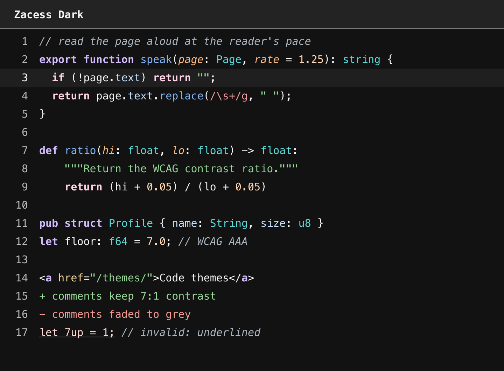

# zacess.nvim



Four Neovim colour schemes matching the [Zacess](https://zacess.com) reader's contrast themes:
`zacess-light`, `zacess-dark`, `zacess-yellow-on-black` for low vision and `zacess-cream` for
dyslexia friendly reading. Every text and syntax colour keeps at least 7:1 contrast on the
background, the selection and the current line. Each scheme sets `background`, the standard
highlight groups, the Tree-sitter `@` groups, the LSP semantic token groups and the 16 terminal
colours.

## Install

With [lazy.nvim](https://github.com/folke/lazy.nvim):

```lua
{
  "zacesshq/zacess.nvim",
  lazy = false,
  priority = 1000,
  config = function()
    vim.o.termguicolors = true
    vim.cmd.colorscheme("zacess-dark")
  end,
}
```

With any other plugin manager, add `zacesshq/zacess.nvim` and run
`vim.cmd.colorscheme("zacess-dark")`. To install by hand, copy the `colors` folder into
`~/.config/nvim/colors/`.

> [!IMPORTANT]
> The schemes use exact colours, so `termguicolors` must be on and the terminal must support true
> colour. Without it Neovim rounds each colour to the nearest of 256 and the contrast is no longer
> what was measured.

## The four schemes

| Scheme | Background |
| --- | --- |
| `zacess-light` | Ink on white |
| `zacess-dark` | Light text on near black |
| `zacess-yellow-on-black` | Yellow on black, for low vision |
| `zacess-cream` | Black on cream, for dyslexia friendly reading |

Previews of all four are in [previews](previews).

## Where the schemes are made

> [!NOTE]
> This repository is a read-only copy for Neovim plugin managers. The schemes are generated from
> one palette in [zacesshq/themes](https://github.com/zacesshq/themes), which also has the
> same themes for VS Code, JetBrains IDEs, Obsidian, Zed and terminals. Issues, ideas and pull
> requests go there.

## Licence

[MIT](LICENSE)
